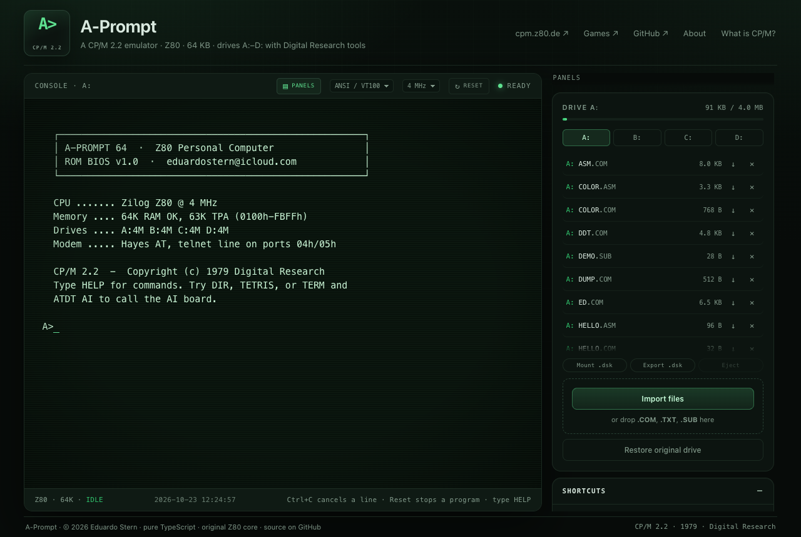
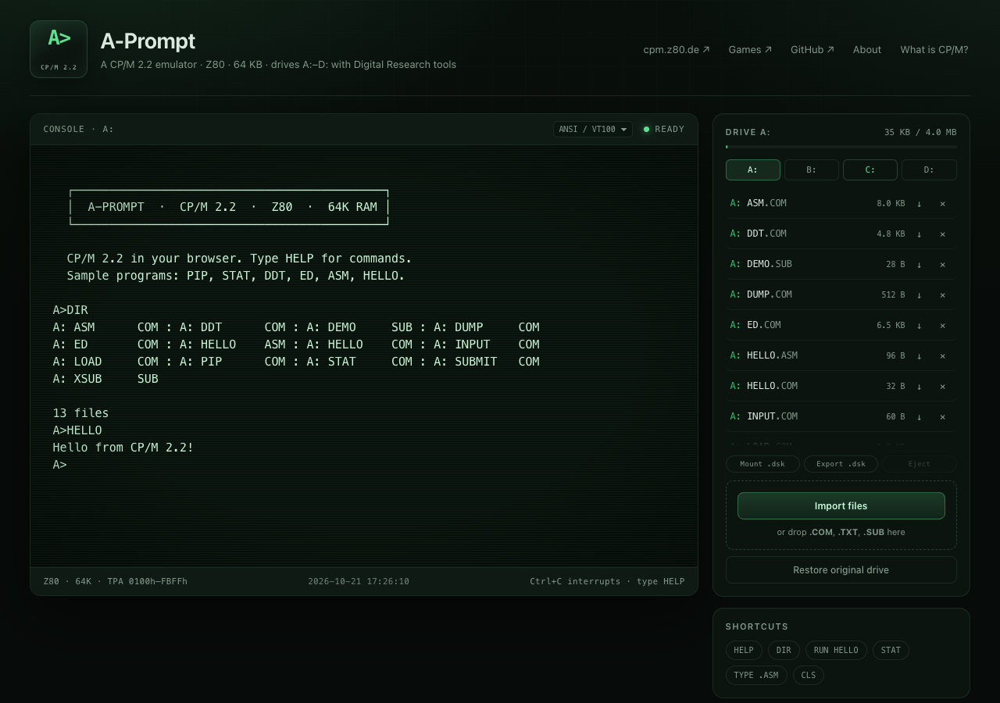
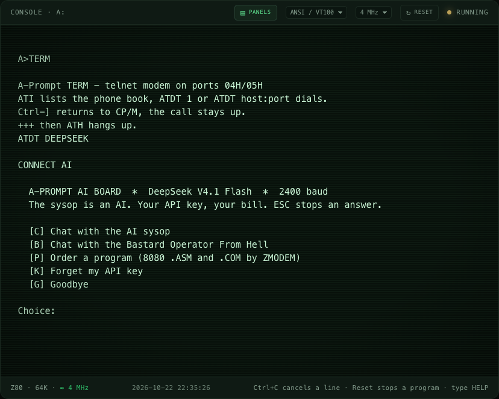

# A-Prompt

[](https://a-prompt.stern.workers.dev)
[](https://github.com/eduardostern/A-Prompt/actions/workflows/ci.yml)
[](https://github.com/eduardostern/A-Prompt)
[](http://www.retroarchive.org/cpm/games/games.htm)
[](#ai-provenance)
[](#calling-the-ai-board)
[](#downloading-and-uploading)
[](LICENSE)

**A-Prompt is a CP/M 2.2 computer in your browser. And it dials out.**

A complete Z80, the original Digital Research software, and a Hayes modem
that calls **real telnet BBSes still running today**: dial tone, touch
tones and the full handshake screech included. Download files from them
with **XMODEM and ZMODEM**. Or dial `DEEPSEEK` and **order a program from
an AI sysop**: it writes 8080 assembly, assembles it with the real
`ASM.COM`, fixes its own errors and sends you the `.COM` by ZMODEM. Or ask
for the **Bastard Operator From Hell**, and listen to him hang up on you.

**[Open the live demo](https://a-prompt.stern.workers.dev)**: no install, no account.



## Try it in 30 seconds

```text
A>TERM                   the terminal program
ATDT 1                   dial Vertrauen, a Synchronet BBS (turn your sound on)
...                      Ctrl-] back to CP/M, the call stays up

ATDT DEEPSEEK            the AI board (needs your own DeepSeek key)
P                        "a number guessing game", name GUESS
                         ...it writes, assembles, fixes, sends...
Ctrl-]  ZMODEM R  GUESS  receive it and play
```

Or stay offline: `TETRIS`, `COLOR`, `DIR`, `STAT`, `ED`, `ASM`, or upload
Zork, WordStar and MBASIC from your own archive.

## Highlights

- **A real CP/M 2.2.** Every Z80 instruction, documented and not
  (`zexdoc` and `zexall` pass), Zilog cycle timing at 2, 4 or 8 MHz, and
  the original DRI binaries: PIP, STAT, ED, ASM, LOAD, DDT, SUBMIT.
- **Dial real BBSes.** A Hayes-style modem on I/O ports 04h/05h: `ATI`,
  `ATDT`, `+++`, `ATH`. Boards with a WebSocket gateway are called straight
  from your browser; the rest through a small Cloudflare Worker relay.
- **Sounds like the 1990s.** Dial tone, DTMF, ringback, the 2100 Hz answer
  tone and the training hiss, synthesized, with `CONNECT` waiting for the
  handshake as it did. `ATM0` for silence. And `^G` rings a VT100 bell at
  the VT100's own 786 Hz.
- **File transfers that work.** `XMODEM.COM` and `ZMODEM.COM`, written in
  8080 assembly and tested byte for byte against lrzsz, including
  corrupted blocks and restarts.
- **An AI on the other end of the line.** `ATDT DEEPSEEK` reaches a board
  run by DeepSeek V4.1 Flash, the model that wrote this emulator. Chat, or
  order a program that arrives assembled and ready to run. Your key stays
  in your browser.
- **The BOFH.** Press `B` and the machine room phone rings. The PFY is
  listening. Mind the Halon button.
- **Period terminals.** ANSI/VT100 with CP437, ADM-3A and VT52 emulation.
- **A CRT on your desk.** The Display panel switches to period fonts (DEC
  VT220, VT323, IBM VGA), green, amber or white phosphor, any background,
  and adds scanlines, phosphor glow, flicker, curved glass, magnetic
  interference and NTSC or PAL colour fringes with a rolling hum bar.
  Share a look with a link: `?display=amber`, or Copy link for your own.
  It starts switched off: a key or click powers it on, with the degauss
  thunk, the picture opening from a bright line, and the boot bell.
- **Serial terminal speed.** Set the line to 300, 1200, 2400, 9600 or
  19200 baud and text crawls onto the screen as it did; programs wait for
  the line, as they waited for the UART.
- **It sounds like a machine.** The floppy drive's motor, the head-load
  clack and a tick for every track it steps across, from what CP/M actually
  reads and writes; key clicks if you want them.
- **Real disks.** Mount and export 8" SSSD, 512K, 4 MB and z80pack hard
  disk images; four drives saved in your browser.
- **Built by AIs for under $1, then finished properly.** See
  [AI provenance](#ai-provenance).

> **An effective Sino-American team.** (A few former-OpenAI tokens were harmed after all.)
>
> Built with [OpenCode](https://opencode.ai) + DeepSeek V4.1 Flash for **under $1**
> in model tokens — the build run cost **$0.92**, other experiments excluded.
> Then [Claude Code](https://claude.com/claude-code) with Claude Opus 5.5 had to
> review it and fix what DeepSeek left behind: CP/M 2.2 compatibility bugs, the
> memory map, standard disk-image formats (including z80pack's), SUBMIT, the
> clock and STAT. Final touches by **Claude Fable 5.1**, where the cheap
> tokens were not up to the task: BIOS DMA alignment, S2 in FCB record
> numbers, F_OPEN's extent, and ^S/^C on console output. The human supplied
> the best idea of the third pass (Tetris tunes itself with CP/M 3's
> `T_GET` instead of a made-up timer port). DeepSeek built it, Claude
> reviewed and fixed it. No GPT or Grok was consulted. Yes, both are transformers — the only *other* transformer
> involved is the one in the power supply.

**Created by [Eduardo Stern](mailto:eduardostern@icloud.com)** · [GitHub](https://github.com/eduardostern)

The name comes from CP/M's unmistakable `A>` prompt.



## Run

```bash
npm install
npm run dev      # http://localhost:5173
npm run build    # static site in dist/
npm run preview  # serve the build
```

No WebAssembly: `dist/` is a plain static site. The only server code is
the Worker's telnet relay (`worker/index.ts`), used for BBSes without a
WebSocket gateway.

The terminal fills the viewport. Use **Panels** in the console toolbar to hide or show the right rail; its sections collapse and scroll independently (on mobile the rail becomes a drawer).

The clock menu in the toolbar sets the Z80 speed: **2**, **4** (default) or
**8 MHz**, or **Max** to run as fast as your computer allows. Period speed
keeps games with timing loops playable. **Reset** stops a runaway program
(drives are kept).

## What works

- **Z80 CPU**: documented and undocumented instructions (SLL, IXH/IXL, DDCB,
  ED block ops, etc.). Passes `zexdoc` and `zexall` (all groups OK). T-states
  follow the Zilog tables and drive the clock limit.
- **CP/M 2.2**: console (with `^S` pause and `^C` abort during output),
  FCBs with the full S2:EX:CR record numbering, sequential and random files,
  directory search, rename, attributes, user areas 0–15, DMA and DPB.
- **CCP**: `DIR`, `ERA`, `TYPE`, `REN`, `USER`, `SAVE`, `CLS`, `HELP`, drive
  selection (A:–D:), and `.COM` execution with command tail and default FCBs.
- **Real `SUBMIT`**: the CCP consumes `$$$.SUB` one record at a time, also
  after the batch changes drive or user area; **`XSUB`** feeds the remaining
  lines to programs that read the console.
- **Terminal profiles**: ANSI/VT100, ADM-3A and VT52 escape-sequence
  translation, with CP437 character mapping. `^G` sounds a VT100-style bell:
  a 786 Hz square wave for a quarter second, as from the VT100 keyboard's
  speaker.
- **Telnet modem**: a Hayes-style modem on I/O ports `04h`/`05h` (also the
  READER/PUNCH device) dials telnet BBSes. `TERM.COM` is a terminal for it:
  `ATI` lists the phone book, `ATDT 1`, `ATDT host:port` or
  `ATDT wss://host:port` dials, `+++` escapes, `ATH` hangs up, and Ctrl-]
  returns to CP/M with the call still up. Browsers cannot open TCP
  sockets: boards with their own WebSocket gateway (marked `*` in `ATI`,
  or any `wss://` address you dial) are reached straight from the
  browser; the rest go over a WebSocket to the site's Worker, which
  connects only to the boards in `src/phonebook.ts`. The modem negotiates
  telnet BINARY mode, so file transfers are 8-bit clean. The speaker plays
  the call: dial tone, touch tones, ringback, the 2100 Hz answer tone and
  the handshake (CONNECT waits for it, as on a real modem), or a busy
  signal. `ATM0` silences it, `ATL0`-`ATL3` set the volume, `AT&W` keeps
  the setting and `ATZ` restores it.
- **File transfer**: `XMODEM.COM` (CRC-16 or checksum; receives 128-byte
  and 1K blocks) and `ZMODEM.COM` (CRC-16, batch receive, restart from the
  last good byte after an error), both tested against lrzsz.
- **AI board**: `ATDT DEEPSEEK` calls a BBS whose sysop is DeepSeek V4.1
  Flash. Chat with it, or with the Bastard Operator From Hell (who may
  hang up on you), or order a program: it writes 8080 assembly, the
  bundled ASM and LOAD assemble it in your browser (errors go back to the
  model to fix, up to three tries), and the `.ASM` and `.COM` come down the
  line by ZMODEM. Bring your own DeepSeek API key.
- **Disk images**: mount/export raw 8" SSSD (77×26, standard skew 6 as in
  cpmtools' `ibm-3740` and z80pack), 512K and 4MB `.dsk`/`.img` images, and
  z80pack's 4MB hard disks (`hd-tools.dsk` and friends).
  BIOS sector I/O (`SELDSK`, `SETTRK`, `SETSEC`, `SETDMA`, `READ`, `WRITE`,
  `SECTRAN`) and a CP/M 2.2 filesystem are implemented, so raw-sector tools
  you bring (disk editors, dump and verify utilities) work on mounted images.
  No such tool is bundled.
- **Clock and devices**: virtual clock via CP/M 3-style `T_GET`/`T_SET`
  (`T_GET` returns the seconds in A as on CP/M 3; TETRIS re-tunes its
  timing loop against it, so it plays at the same pace at any MHz setting)
  (BDOS 104/105) and `DATE`; printer and punch bytes captured to
  downloadable logs (BDOS 4/5 and BIOS LIST/PUNCH; punch output also goes
  to the modem).
- **Upload/download** from the drive panel; drives A:–D: (4 MB each, laid
  out like a z80pack hard disk: 2K blocks, 1024 directory entries, so `STAT`
  shows real free space) are saved compressed in the browser's
  `localStorage`, with user areas and R/O/SYS attributes.

Bundled programs: **PIP**, **STAT**, **DDT**, **ED**, **ASM**, **LOAD**,
**SUBMIT**, **DUMP**, **HELLO.COM**, **INPUT.COM**, **COLOR.COM** (shows the
ANSI palette), **TETRIS.COM** (a colour Tetris for the ANSI terminal),
**TERM.COM** (a terminal for the telnet modem), **XMODEM.COM** and
**ZMODEM.COM** (file transfer over it), with their 8080 sources, plus
**DEMO.SUB** and **XSUB.SUB**.

```text
A>DIR
A>HELLO
A>STAT
A>ED HELLO.ASM
A>ASM HELLO.ASM
A>LOAD HELLO
A>SUBMIT DEMO
A>SUBMIT XSUB
A>DATE
A>COLOR
A>TETRIS
A>TERM
```

### Calling a BBS

```text
A>TERM
ATI                      lists the phone book (* = direct WebSocket)
ATDT 1                   dials entry 1 (Vertrauen): CONNECT DIRECT
ATDT 3                   dials entry 3 (Black Flag) through the relay
ATDT wss://host:port     any BBS WebSocket gateway, straight from the browser
ATM0&W                   speaker off for good (ATM1&W to bring it back)
...                      Ctrl-] returns to A> with the call still up
```

Pick the ANSI/VT100 terminal profile for ANSI art. Direct calls come from
the user's own IP; relayed calls come from Cloudflare's. To add a board, add
it to `src/phonebook.ts` (the relay refuses anything else) and redeploy.
During `npm run dev`, run `npx wrangler dev` alongside: Vite forwards
`/relay` to it.

### Downloading and uploading

Pick ZMODEM (or XMODEM) in the BBS's file area. TERM notices a ZMODEM
transfer starting and says what to run:

```text
[TERM: ZMODEM download - press Ctrl-] then ZMODEM R]
A>ZMODEM R               receives the files the BBS sends (ZMODEM R B: for B:)
A>ZMODEM S MYFILE.TXT    uploads, when the BBS waits for a ZMODEM upload
A>XMODEM R FILE.ZIP      XMODEM needs the name on this side too
A>XMODEM S FILE.ZIP
A>TERM                   back to the BBS; +++ then ATH hangs up
```

Unix names become 8.3 (`my long.name.tgz` arrives as `MY-LONG-.TGZ`), and
received files are padded to whole 128-byte records with `^Z`, as CP/M
stores them. Ctrl-X cancels a transfer. Timeouts count seconds from the
CP/M 3 `T_GET` clock (BDOS 105).

### Calling the AI board



```text
A>TERM
ATDT DEEPSEEK            CONNECT AI, then the board's menu
  [C] Chat with the AI sysop
  [B] Chat with the Bastard Operator From Hell
  [P] Order a program (8080 .ASM and .COM by ZMODEM)
P                        "a 10x10 multiplication table", name MULTAB
                         ... thinking, assembling, fixing ...
Ctrl-]                   then ZMODEM R, then MULTAB
```

The board needs your own DeepSeek API key; calls are billed to your
DeepSeek account. To get one:

1. Open [platform.deepseek.com](https://platform.deepseek.com) and sign up.
2. Add a little credit on [Top up](https://platform.deepseek.com/top_up):
   the API is pay as you go, and with no balance calls fail with
   "insufficient balance".
3. Open [API keys](https://platform.deepseek.com/api_keys), choose
   **Create new API key**, name it "A-Prompt" and copy it (it starts with
   `sk-`; copy it now, you may not see it again).
4. Paste it into the **AI board (DeepSeek)** panel and press Save, or type
   it when the board asks.

The key is kept in this browser's localStorage and sent only to
`api.deepseek.com`, straight from the page (DeepSeek allows it; nothing goes
through the A-Prompt Worker). Anyone using the same browser profile can use
it: press Forget, or delete the key on DeepSeek's API keys page, to revoke
it. ESC stops an answer; text arrives at an emulated 2400 baud.

`[B]` rings the machine room of the Bastard Operator From Hell, played as
close to Simon Travaglia's character as the model can manage: the PFY in
asides, the Boss and the Beancounters, the excuse calendar, "What's your
username?", the Halon button. He picks up the phone himself, as the
stories begin, and the scenes are new: nothing is quoted from the
stories. Annoy him enough and he ends his reply with a click and drops
your carrier.

## Running games

**Archive:** <http://www.retroarchive.org/cpm/games/games.htm>

Direct downloads:
[Sargon 2.1](http://www.retroarchive.org/cpm/games/sargon.zip) ·
[Nemesis](http://www.retroarchive.org/cpm/games/nemesis.zip) ·
[Zork I–III](http://www.retroarchive.org/cpm/games/zork123_80.zip) ·
[Adventure + many games](http://www.retroarchive.org/cpm/games/manygame.zip)

Most CP/M `.COM` games work if you upload the program and any data files with
their exact 8.3 names. The **Install game .zip** button accepts a downloaded
zip, installs its files on the selected drive, and runs the game when the
main `.COM` is unambiguous. You can also drop a zip on the drive panel.

### Sargon 2.1

1. Click **Sargon ↓** and save `sargon.zip`.
2. Keep drive **A:** selected and click **Install game .zip**; choose the zip.
3. It installs `SARGON.COM` and starts it automatically.
4. Answer the prompts: error bell `N`, `G` for a new game, printer `N`,
   color `W`, level `1`, display board `Y`.

### Nemesis

1. Click **Nemesis ↓** (the zip includes a scanned manual and is ~6 MB).
2. **Install game .zip** → `nemesis.zip`. It installs 36 files and starts
   `NEMESIS`.
3. Nemesis needs `TERM.DEF`. Run `TERMDEF` once:

   ```text
   A>TERMDEF
   ```

   - Answer `N` to “exit and change disks?”
   - Choose `2` (define terminal), then `9` (DEC VT-52/VT-100)
   - Use `6` to test, `7` to install, `8` to exit
   - Select **ANSI / VT100** (or VT52) in the A-Prompt toolbar to match
4. Create a character with `PERSON` (follow its prompts).
5. Start the game:

   ```text
   A>NEMESIS ALICE
   ```

### Zork I–III

The Zork archive uses the old **Implode** compression, which the in-app
installer cannot decode (it shows a “legacy Implode” message).

1. Click **Zork I–III ↓** and download `zork123_80.zip`.
2. Extract it with your OS (double-click on macOS, “Extract All” on Windows,
   `unzip` on Linux).
3. Drag `ZORK1.COM` and `ZORK1.DAT` onto the Drive A: panel. For the sequels,
   also add `ZORK2.COM`/`ZORK2.DAT` and `ZORK3.COM`/`ZORK3.DAT`.
4. Start it:

   ```text
   A>ZORK1
   ```

   (Use `ZORK2` / `ZORK3` for the others.)

### Adventure (manygame.zip)

`manygame.zip` contains several games. Installing the whole zip works, but it
is cleaner to upload only the Adventure files.

1. Click **Adventure + more ↓** and extract `manygame.zip`.
2. Upload these files from `ADVENT~2/` to drive A:
   `ADVENTUR.COM`, `ATAB.DAT`, `COMMON.DAT`, `KTAB.DAT`, `LTEXT.DAT`,
   `RTEXT.DAT`, `STEXT.DAT`, `TRAVEL.DAT`, `USQ.COM`, `ADVENTUR.MQG`.
3. If `COMMON.DAT` already exists as 0 bytes, delete it first.
4. Decode the squeezed message file:

   ```text
   A>USQ ADVENTUR.MQG
   ```

   Press Enter to accept `ADVENTUR.MSG`.
5. Run it and enter any three digits when asked:

   ```text
   A>ADVENTUR
   ```

Select ADM-3A or VT52 in the console toolbar if a game assumes one of those
terminals.

**Copyright:** old does not mean public domain. Zork, Sargon and most 1980s
titles are still protected (in the US, works published after 1978 are commonly
protected for 95 years). A-Prompt does not bundle or redistribute these games;
the links point to RetroArchive, which hosts them for preservation. Check the
terms of each archive and your local law before downloading.

**Legacy zips:** the built-in installer handles standard ZIPs (Sargon,
manygame). The Zork archive uses the old Implode method; extract it with your
OS unzip tool and drop the `.COM`/`.DAT` files on a drive (or re-zip it with
Deflate).

## Deploy on Cloudflare

A-Prompt is a static site plus one small Worker script: no environment
variables, no database. The whole CP/M disk image is embedded in the
JavaScript bundle. The Worker (`worker/index.ts`) only handles `/relay`,
the telnet relay for the modem.

### Workers (current dashboard flow)

1. **Workers & Pages → Create → Connect to Git** and select the repo.
2. Build command: `npm run build`
3. Deploy command: `npx wrangler deploy`
4. Node version: 22 (the repo includes `.nvmrc`).
5. Deploy.

`wrangler.toml` publishes `./dist` as **Workers Static Assets** and routes
only `/relay` to the Worker script. On Pages there is no relay, so the
modem answers `NO CARRIER`.

From the CLI:

```bash
npm run build
npx wrangler deploy
```

### Pages (legacy flow)

If you prefer the Pages workflow, click **“Continue to Pages”** on the create
screen and use:

- Build command: `npm run build`
- Build output directory: `dist`
- Node version: 22

Or deploy from the CLI:

```bash
npm run build
npx wrangler pages deploy dist
```

In both cases, uploads and files created inside CP/M are stored in the
visitor's browser (`localStorage`), so every visitor has their own drive A:.

## Software

These are the CP/M classics. A-Prompt does not bundle them; download the
original files from RetroArchive and install them with **Install .zip** (or
**Import files** for a single `.COM`).

### WordStar 3.3

1. Download [WS330.zip](http://www.retroarchive.org/cpm/text/WS330.zip).
2. **Install .zip** → `WS330.zip`.
3. Run `WINSTALL` and choose your terminal (ANSI Standard).
4. Start the editor with `WS` (or `WSU` after installation).

### MBASIC / BASIC-80 5.21

1. Download [Mbasic.com](http://www.retroarchive.org/cpm/lang/Mbasic.com).
2. Drag the `.COM` onto drive A (or **Import files**).
3. Run `MBASIC`; you should see `BASIC-80 Rev. 5.21` and an `Ok` prompt.
4. Leave BASIC with `SYSTEM`.

### dBASE II 2.3B (works)

The Kaypro 2.43 build and the 2.4 build install but stall in a blank overlay
loop. The **2.3B generic build works**:

1. Download [ASHTONPAK.ZIP](http://www.retroarchive.org/cpm/dbase/ashtonpak.zip)
   (1.2 MB; it contains several Ashton-Tate programs).
2. Extract only `DBASE-II/CPM80/V2-3B/` from the zip.
3. Upload all files from that folder to a drive (or zip just that folder and
   use **Install .zip**).
4. Run `DBASE`; press **Enter** at `ENTER TODAYS DATE AS MM/DD/YY` and you get
   the dot prompt.

Tested: `dBASE II Ver 2.3B 22 FEB 82`, `. ? 2+2` → `4`. The Kaypro-specific
2.43 build still has the blank-screen problem and is not recommended.

### Turbo Pascal 3

1. Download [tpas30.zip](http://www.retroarchive.org/cpm/lang/tpas30.zip).
2. **Install .zip** → `tpas30.zip`.
3. Run `TINST` once to set your terminal, then `TURBO`.

Tested: it boots into the Turbo Pascal 3.00A IDE (default “Kaypro with
hi-lite” terminal); use `TINST` to switch to ANSI.

### SuperCalc 1.x / 2

1. Download [Suprcalc.zip](http://www.retroarchive.org/cpm/business/Suprcalc.zip)
   or [sc2.zip](http://www.retroarchive.org/cpm/business/sc2.zip).
2. **Install .zip**.
3. Run `INSTALL` → `M` (ANSI Standard) → confirm → `A` save → `X` quit.
4. Start with `SC` (or `SC2`).

`INSTALL` works and saves the ANSI configuration; `SC` 1.x still did not draw
the spreadsheet in testing. Try `SC2`, and select the matching terminal
profile.

All of these are still copyrighted; the links point to the original archive.
The emulator only installs files you download.

## Disk images

Drives A:–D: are host-folder drives by default. Use **Export .dsk** to turn
one into a raw 8" image, then **Mount .dsk** on any drive to work with raw
sectors. The image panel supports 8" SSSD (77 tracks × 26 sectors), 512K and
4MB images; the CP/M filesystem is decoded and rebuilt automatically.

8" images use the standard IBM 3740 layout (skew 6), so disks from cpmtools
(`ibm-3740`) and z80pack mount directly, and exported images open there.

z80pack's 4MB hard disk images (4,177,920 bytes: 255 tracks × 128 sectors,
2K blocks, 1024 directory entries, 16-bit block pointers — z80pack's `HDBLK`)
also mount, e.g. `hd-tools.dsk` from `cpmsim/disks/library`.

Drives are saved in the browser compressed (deflate), so a 4MB disk
fits in `localStorage`: `hd-tools.dsk`, 2.4MB of programs, takes about 1.5M
characters instead of 5.6M. If a disk still does not fit (a full disk of
already-compressed archives, say), the drive panel says so; the session keeps
working and **Export .dsk** saves a copy.
Images exported by earlier A-Prompt versions (unskewed) are recognised and
still read correctly. BIOS sector numbers are logical (0-based, `SECTRAN` is
1:1); the skew is applied when sectors are stored. A program that writes more
than the image holds gets a "disk full" error instead of losing data.

With an image mounted, BIOS-level tools from your own CP/M collection (disk
editors such as `DU`, dump and verify utilities) can read and write sectors;
none is bundled with A-Prompt. **Eject** converts the image back into the in-memory
file list (use **Export .dsk** to keep it).

## Limitations

- Drive A: is a host-folder drive by default. Raw-sector tools (disk
  editors, formatters) need a mounted image; export A: as `.dsk` and mount
  it first. None is bundled; bring your own.
- CP/M 2.2 only (not CP/M 3). The clock is available through CP/M 3-style
  `T_GET`/`T_SET` calls.
- Through the Worker, the modem reaches only the telnet BBSes in the phone
  book; other boards need a WebSocket gateway (`ATDT wss://…`). ZMODEM
  sends one file per run and does not offer CRC-32; YMODEM and Kermit are
  not included.
- Terminal profiles cover ANSI/VT100, ADM-3A and VT52; software that requires
  another terminal (Hazeltine, Televideo, Wyse, etc.) may render oddly.

## What is CP/M?

CP/M — **Control Program for Microcomputers** — was the first widely
standard operating system for microcomputers. Gary Kildall wrote it at Digital
Research in 1974; CP/M 2.2, the version this emulator implements, arrived in
1979. It became the default OS for 8080/Z80 business machines: Altair,
Osborne, Kaypro, Xerox, North Star, Epson and many others.

**Why the Z80?** CP/M was written for the Intel 8080. The Z80 is
binary-compatible with the 8080, cheaper, and adds instructions and registers.
Most CP/M software is plain 8080 code and runs on a Z80 unchanged.

**The standardization trick** was splitting the machine into three layers:

- **BIOS** — the hardware-specific part (console, disk controller)
- **BDOS** — files, directory, console and the API reached through `CALL 5`
- **CCP** — the `A>` prompt and built-in commands

Programs never touched the hardware directly. Add shared conventions — 8.3
filenames, 128-byte records, FCBs, user areas, the TPA, `.COM` files — and the
same binary could run on completely different machines.

**What ran on it:** WordStar, dBASE II, SuperCalc, MultiPlan, Turbo Pascal,
MBASIC, FORTRAN, COBOL, assemblers, and games such as Sargon, Zork, Adventure
and Nemesis.

### VisiCalc and SuperCalc

VisiCalc (1979, Dan Bricklin and Bob Frankston) was the first spreadsheet and
the “killer app” of personal computing. It did have CP/M ports, but they were
niche: the **HP 125** and **Sony SMC-70** versions are the CP/M releases. The
mass-market VisiCalc ran on the Apple II, Atari, TRS-80 and IBM PC.

The spreadsheet that actually shipped with CP/M business machines was
**SuperCalc** (Sorcim, 1980; bundled with the Osborne 1). A-Prompt links to it
from the **Software** card:

- [SuperCalc 1.x](http://www.retroarchive.org/cpm/business/Suprcalc.zip)
- [SuperCalc 2](http://www.retroarchive.org/cpm/business/sc2.zip)

Install the zip, then configure the terminal once:

```text
A>INSTALL
```

Answer `Y`, choose `M` (ANSI Standard), confirm, then `A` to save and `X` to
quit. Start it with `SC` (or `SC2` for version 2). Neither program is bundled;
both are still copyrighted.

A-Prompt does not bundle VisiCalc or SuperCalc. If you have a CP/M `.COM`,
upload it to a drive and run it.

- [CP/M on Wikipedia](https://en.wikipedia.org/wiki/CP/M)
- [VisiCalc on Wikipedia](https://en.wikipedia.org/wiki/VisiCalc)
- [SuperCalc on Wikipedia](https://en.wikipedia.org/wiki/SuperCalc)

## Architecture

| File | Role |
| --- | --- |
| `src/z80.ts` | Z80 interpreter: flags, prefixes, T-states |
| `src/cpm/disk.ts` | In-memory drive, 8.3 names, wildcards, user areas |
| `src/cpm/image.ts` | Raw `.dsk` images, CP/M 2.2 directory and block allocation |
| `src/cpm/bdos.ts` | BDOS calls (`CALL 5`) and CP/M directory |
| `src/cpm/ccp.ts` | Shell, FCB parsing, `SUBMIT` |
| `src/cpm/layout.ts` | Memory map addresses |
| `src/cpm/machine.ts` | BDOS/BIOS traps, execution loop, clock limit |
| `src/cpm/modem.ts` | Hayes-style modem, telnet options |
| `src/phonebook.ts` | Telnet BBSes the relay allows, and their WebSocket gateways |
| `src/terminal.ts` | xterm.js + CP437 + keyboard |
| `src/bell.ts` | VT100 bell (Web Audio) |
| `src/modem-audio.ts` | Modem speaker: dial, DTMF, ring, handshake, busy |
| `src/call-sound.ts` | Holds CONNECT and early data until the handshake ends |
| `src/aiboard.ts` | The AI board: menu, chat, program orders |
| `src/deepseek.ts` | DeepSeek streaming client (browser, your key) |
| `src/zmodem.ts` | ZMODEM sender in TypeScript, for the AI board |
| `src/cpm/assembler.ts` | ASM + LOAD in a headless CP/M machine |
| `worker/index.ts` | Cloudflare Worker: WebSocket-to-telnet relay |

The memory map is the classic one: `0000h` jumps to the BIOS warm boot and
`0005h` to the BDOS entry at `FC06h`. Everything the system owns (CCP stack,
allocation vector, BIOS jump table at `FE00h`, DPH/DPB, directory buffer) sits
above it, so programs can use the whole TPA from `0100h` to `FBFFh`. Calls
are intercepted on the host, which lets the BDOS wait for keyboard input
without blocking the UI.

## Tests

```bash
npm test                   # CP/M + Z80 tests (fast)
ZEX=1 npm test             # adds the zexdoc/zexall exercisers (long)
```

`zexdoc`/`zexall` are Frank Cringle's Z80 instruction exercisers (public
domain) and live in `tests/fixtures/`.

## AI provenance

An effective Sino-American team:

1. **Build — DeepSeek.** The emulator was written with
   [OpenCode](https://opencode.ai) and **DeepSeek V4.1 Flash** for **less than
   $1 in model tokens** — the build run cost **$0.92**; other experiments are
   not included. It got the hard part right: the Z80 core passes `zexdoc` and
   `zexall`.
2. **Review and fixes — Claude.** [Claude Code](https://claude.com/claude-code)
   with **Claude Opus 5.5** then had to review it and fix what it found, each
   fix with a regression test:
   - BDOS: non-blocking console polling, status checks that swallowed keys,
     DMA and open files carried between programs, random-record position, a
     stale open-file cache, directory search returning every extent.
   - Memory map: the BIOS sat inside the TPA, so programs could overwrite it.
   - Disk images: standard 8" skew, correct EXM, files over 512K, z80pack 4MB
     hard disks, and no data loss when an image fills up.
   - SUBMIT across drives and user areas, STAT free space, the drive prompt
     after a disk reset, and a real Z80 clock limit with Zilog T-states.
3. **Final touches — Claude Fable 5.1.** A second audit with the same tool
   and a stronger model, where the cheap tokens were not up to the task:
   BIOS READ/WRITE wrote to a 128-byte-aligned address instead of the DMA
   address, FCB record numbers ignored S2 (EX overflowed past 31 on files
   over 512K), F_OPEN discarded the requested extent and CR, BDOS 13 did not
   reset DMA, console output ignored ^S/^C, BDOS 10 read past a full buffer,
   and Z80 R/interrupt details. Each fix has a regression test that fails
   on the earlier code; `zexdoc` and `zexall` still pass.
4. **The human had the better idea.** Fable then wrote `COLOR.COM` and
   `TETRIS.COM` in 8080 assembly. Asked to make Tetris play at the same
   pace at any MHz setting, it did what emulator authors do: invented a
   millisecond timer on I/O ports E0h/E1h. Eduardo asked whether a
   *compliant* mechanism could measure the clock at start and adjust
   instead. It could: BDOS 105 (CP/M 3 `T_GET`) returns the seconds, so
   the game now counts its ticks per clock second and rescales its loop,
   staying ordinary CP/M software that also runs on real CP/M 3 and other
   emulators. The ports were removed. Measured: 128 ticks take 8.0 s at
   2 MHz, 8 MHz and Max.
5. **Telnet modem — Claude Opus 5.5.** Asked for a serial-to-telnet
   bridge, Opus 5.5 added a Hayes-style modem on two I/O ports, `TERM.COM`
   in 8080 assembly, a Worker relay limited to a phone book of BBSes, and
   the VT100 bell (786 Hz for a quarter second, from MAME and the VT100
   Technical Manual). Then `XMODEM.COM` and `ZMODEM.COM`, also in 8080
   assembly and tested byte for byte against lrzsz (including corrupted
   blocks and restarts), telnet BINARY mode, and direct dialing of BBS
   WebSocket gateways.
6. **DeepSeek comes home.** The human asked for a CP/M-to-AI bridge on
   DeepSeek V4.1 Flash, the model that built the emulator. Opus 5.5 wired
   it in as one more number to dial: `ATDT DEEPSEEK` reaches a board where
   Flash chats as the sysop and writes 8080 programs, which are assembled
   in the page by the very ASM.COM Flash's emulator runs, fixed from ASM's
   own error lines, and delivered by a ZMODEM sender written for the
   purpose. The model that wrote the machine now lives on the other end of
   its modem.

No GPT, Grok, or other OpenAI/xAI model was involved. Both DeepSeek and Claude
are transformers, of course; the only *other* transformer here is the one in
the power supply. A few former-OpenAI tokens were harmed after all.

## Author

**Eduardo Stern** — <eduardostern@icloud.com> — [github.com/eduardostern](https://github.com/eduardostern)

A-Prompt was designed and built by Eduardo Stern. See `AUTHORS`.

## Credits and license

- A-Prompt source, UI, tests and original documentation: **MIT**, © 2026
  Eduardo Stern (`LICENSE`).
- CP/M binaries: © Digital Research, redistributed under the license granted
  by DRDOS, Inc. / Bryan Sparks, available at
  [cpm.z80.de/license.html](http://www.cpm.z80.de/license.html).
- `HELLO`, `COLOR`, `TETRIS`, `TERM`, `XMODEM`, `ZMODEM` (`.COM` and `.ASM`) and `DEMO.SUB` are original
  examples for this project, assembled with the bundled ASM and LOAD.
- xterm.js, fflate and other dependencies retain their own MIT licenses.
- Terminal fonts (`src/fonts/`, unmodified): Glass TTY VT220 by Viacheslav
  Slavinsky (public domain); VT323 by Peter Hull (SIL OFL 1.1); IBM VGA 8x16
  from [The Ultimate Oldschool PC Font Pack](https://int10h.org/oldschool-pc-fonts/)
  by VileR ([CC BY-SA 4.0](https://creativecommons.org/licenses/by-sa/4.0/)).
- `zexdoc`/`zexall` are Frank Cringle's public-domain Z80 exercisers.
